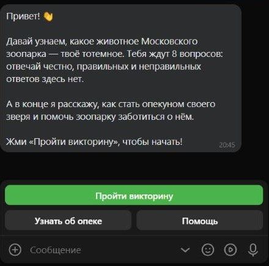
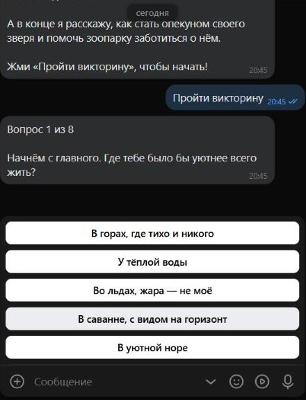
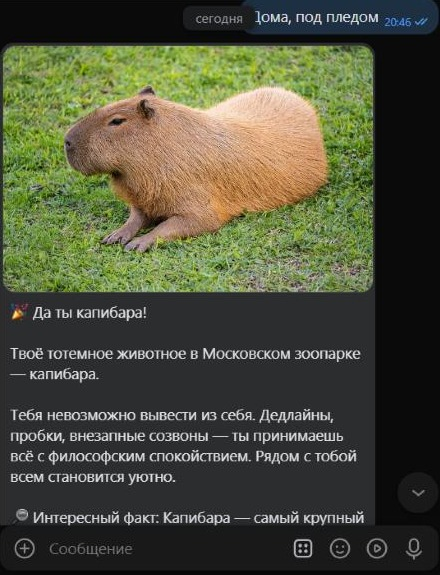
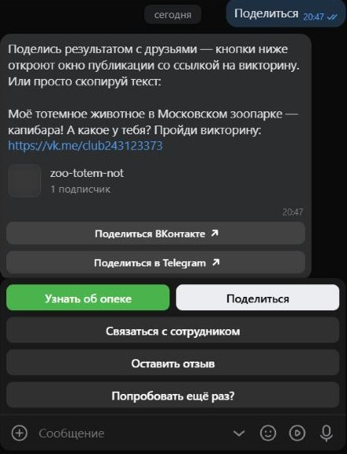
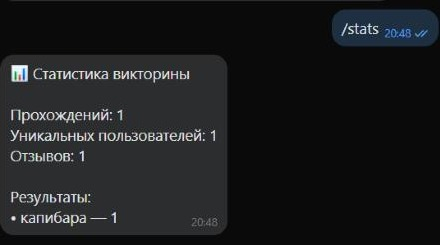

# Zoo Totem VK Bot — "What's your totem animal?"

**English** | [Русский](README.ru.md)

[](https://github.com/R00tPengu1n/Zoo-Totem-VK-Bot/actions/workflows/ci.yml)


[](LICENSE)


A VK quiz bot that promotes the Moscow Zoo "Adopt an animal" guardianship program. The user answers 8 light-hearted questions, the bot matches them with a totem animal from the zoo, sends a realistic photo with a description and explains how to become the animal's guardian.

The bot's interface is in Russian.

**Try the bot:** [open a chat on VK](https://vk.me/club243123373)

## Demo

<table align="center">
  <tr>
    <td align="center"><br><sub>Welcome</sub></td>
    <td align="center"><br><sub>Question</sub></td>
    <td align="center"><br><sub>Result with a photo</sub></td>
  </tr>
  <tr>
    <td align="center"><br><sub>Sharing the result</sub></td>
    <td align="center"><br><sub>Admin <code>/stats</code> command</sub></td>
    <td></td>
  </tr>
</table>

## Features

- **8-question quiz** with answer buttons and a progress counter
- **10 possible results**: Pallas's cat, meerkat, capybara, lion, giraffe, polar bear, flamingo, porcupine, Przewalski's horse and Humboldt penguin
- **Result with a photo**: the image is uploaded to VK via `photos.getMessagesUploadServer` and `photos.saveMessagesPhoto`, then cached
- **Guardianship program info** with a link button to the program page
- **Share** the result on VK and Telegram, with a link back to the bot
- **Contact a zoo employee**: the user's question is forwarded together with their quiz result
- **Feedback** is stored in the database
- **"Try again?"**: restart the quiz at any time
- **Admin statistics** via the `/stats` command
- **Guidance at every step**: help, cancel, and replies to unrecognized messages
- **Private messages only**: messages from group chats are ignored

## Tech stack

- Python 3.12+
- [vkbottle](https://github.com/vkbottle/vkbottle) — asynchronous VK bot framework
- [SQLAlchemy 2.0](https://www.sqlalchemy.org/) (async) + SQLite, ready to switch to PostgreSQL
- [Pydantic](https://docs.pydantic.dev/) and pydantic-settings — content and settings validation
- [aiohttp](https://docs.aiohttp.org/) — photo uploads to VK
- pytest for tests, Docker for deployment

## Architecture

```
├── bot/
│   ├── __main__.py          # Entry point: python -m bot
│   ├── config.py            # Settings from .env
│   ├── loader.py            # Shared objects: API, state storage, services
│   ├── logging_config.py    # Console and rotating file logs
│   ├── monitoring.py        # Handler timing and error capture
│   ├── middlewares.py       # Ignoring group chats
│   ├── rules.py             # Handler matching rules (buttons and commands)
│   ├── states.py            # Dialog states
│   ├── keyboards.py         # Keyboards
│   ├── texts.py             # All user-facing texts
│   ├── handlers/            # Message handlers
│   ├── services/
│   │   ├── content.py       # Loading and validating questions and animals
│   │   ├── quiz_engine.py   # Result calculation — pure logic, no VK
│   │   ├── photos.py        # Uploading photos to VK with caching and preloading
│   │   ├── startup_checks.py # VK group settings check at startup
│   │   └── notifier.py      # Forwarding questions to an employee
│   └── db/                  # Models, connection and queries
├── data/
│   ├── questions.json       # Questions, answers and weights
│   ├── animals.json         # Animals: description, fact, photo
│   └── images/              # Animal photos
├── tests/
├── .github/workflows/ci.yml # CI: ruff check, ruff format, pytest
├── Dockerfile
└── docker-compose.yml
```

### How the result is calculated

Each answer option gives points to one or more animals:

```json
{"text": "В уютной норе", "weights": {"porcupine": 3, "meerkat": 2}}
```

Points are summed across all answers and the animal with the highest total wins; ties are broken randomly among the leaders. The weights are balanced so that with random answers every animal comes up in roughly 9–12% of cases, and the `test_every_animal_can_win` test ensures every animal is reachable.

### Key decisions

- **Content is separated from code.** Questions and animals live in JSON and can be edited without a developer. On startup the files are validated with Pydantic models: button label length, valid weights, existing photos. Invalid content stops the bot from starting with broken data.
- **Scoring logic is isolated.** `quiz_engine` has no VK or database dependencies and is covered by unit tests.
- **Photos are uploaded once.** The attachment id is stored in the database together with the file hash; if an image is replaced, the bot uploads the new version automatically.
- **Group settings check at startup (fail fast).** Before starting, the bot asks VK for the community settings (`bot/services/startup_checks.py`). If Long Poll is disabled or the "Incoming message" event is not ticked, the bot refuses to start and logs where to enable it. An invalid access key also stops the startup with a hint to check `VK_TOKEN`. "Bot capabilities" cannot be read with a community key, so this setting is not checked at startup: if it is off, the bot logs a hint on the first VK error 912 at runtime. If the check itself cannot be performed (network, VK outage), it only logs a warning. The decision is made by the pure function `find_problems`, which is unit-tested without network access.
- **Background photo preloading.** On startup the photos of all animals are uploaded to VK in the background (`PhotoService.preload`) and cached, so the bot start is not delayed and the first reply with a photo is not slow.
- **Private messages only.** Quiz progress is keyed by the chat, so in a group chat the answers of different people would mix. A middleware (`bot/middlewares.py`) ignores messages from group chats.
- **Monitoring.** Every handler is wrapped in a decorator that measures processing time, warns about slow responses, logs errors with tracebacks and replies to the user with a clear message.
- **Privacy.** The database stores only the VK id, quiz result, date and feedback text. The user's name is requested only for the message to the employee and is never stored. The token lives in `.env` and never gets into the repository.
- **Scalability.** Asynchronous code on vkbottle and SQLAlchemy; switching to PostgreSQL is a matter of changing `DATABASE_URL`.

## Setup

### 1. VK community setup

1. Enable **community messages**: Manage → Messages.
2. In the same place, under **Messages → Bot settings**, turn on **Bot capabilities**.
3. **Manage → API usage**: create an access key with permissions "community management", "community messages" and "photos". This is the value of `VK_TOKEN`.
4. **API usage → Long Poll API**: enable Long Poll and choose the latest API version.
5. On the **Event types** tab tick **"Incoming message"**.
6. The employee who receives questions must send at least one message to the community (otherwise VK will not let the bot write to them first).
7. Set `BOT_LINK` as `https://vk.me/club<community ID>` or with a short name: `https://vk.me/<short name>`.

The bot checks items 4 and 5 on startup and tells you in the log what to enable. Item 2 cannot be checked with a community key: if it is off, the bot logs a hint when VK returns error 912.

### 2. Running locally

```bash
git clone https://github.com/R00tPengu1n/Zoo-Totem-VK-Bot.git
cd Zoo-Totem-VK-Bot
python -m venv .venv
```

Windows: `.venv\Scripts\activate`, Linux / macOS: `source .venv/bin/activate`

```bash
pip install -r requirements.txt
```

Create `.env` based on `.env.example` and fill in `VK_TOKEN`, `ADMIN_VK_ID` and `BOT_LINK`.

```bash
python -m bot
```

### 3. Running with Docker

```bash
docker compose up -d --build
```

The database and logs are stored on the host in `storage/` and `logs/`.

## Configuration

| Variable | Description |
|---|---|
| `VK_TOKEN` | Community access key |
| `ADMIN_VK_ID` | id or screen name of the employee who receives questions |
| `BOT_LINK` | Link to the bot chat used by the Share button |
| `GUARDIANSHIP_URL` | Guardianship program page |
| `CONTACT_EMAIL` | Email offered if forwarding a question fails |
| `DATABASE_URL` | Database connection string (SQLite in `storage/bot.db` by default) |
| `LOG_LEVEL` | Logging level |
| `SLOW_HANDLER_THRESHOLD` | Slow handler threshold in seconds |

## Editing the quiz

- **Questions and answers** — `data/questions.json`. An answer label must be at most 40 characters (VK limit); each question has 2 to 6 options.
- **Animals** — `data/animals.json`, photos — `data/images/`.
- After editing, run `pytest`: the tests check that the content is valid and every animal can come up.

## Tests and CI

```bash
pip install -r requirements-dev.txt
pytest
ruff check .
ruff format --check .
```

GitHub Actions (`.github/workflows/ci.yml`) runs `ruff check .`, `ruff format --check .` and `pytest -q` on every push to `main` and on every pull request.

## Troubleshooting

| Symptom | Cause and fix |
|---|---|
| `longpoll for this group is not enabled` (VK error 100) | Long Poll is disabled in the community. Enable it: Manage → API usage → Long Poll API. |
| The bot is running but silent, no messages arrive | "Incoming message" is not ticked on the "Event types" tab. The bot checks this on startup and logs a clear error. |
| `VKAPIError 912: This is a chat bot feature`, the user sees "Ой, что-то пошло не так" | "Bot capabilities" are disabled: Manage → Messages → Bot settings. The bot logs a hint. |
| The bot stops on startup: "проверь VK_TOKEN" | VK rejected the community access key (error 5). Create a new key and put it into `.env`. |
| The bot is unstable or replies erratically | Two bot instances are running and Long Poll conflicts. Keep only one (check both the local run and the Docker container). |
| The first reply with a photo is slow | Photos are uploaded to VK in the background on startup and cached (`PhotoService.preload` in `bot/services/photos.py`). Until preloading finishes, the first photo may take longer. Group settings check on startup: `bot/services/startup_checks.py`. |

## About this project

A learning project from the SkillFactory course "Python Developer PRO". The topic comes from a course assignment themed around the Moscow Zoo "Adopt an animal" program. It is coursework, not a commission and not a product of the zoo.

## Limitations and roadmap

- Quiz progress is kept in memory and is lost when the bot restarts. The next step is a Redis-backed state storage.
- Tables are created automatically on startup; schema changes in production should go through Alembic migrations.
- Possible improvements: a result card image for posting on the wall, an admin panel for editing questions, news updates about the adopted animals.

## License

Code: [MIT](LICENSE). Photos: free licenses of their authors, see [CREDITS.md](CREDITS.md).

---

This project is not an official Moscow Zoo product.

## Author

GitHub: [@R00tPengu1n](https://github.com/R00tPengu1n)
