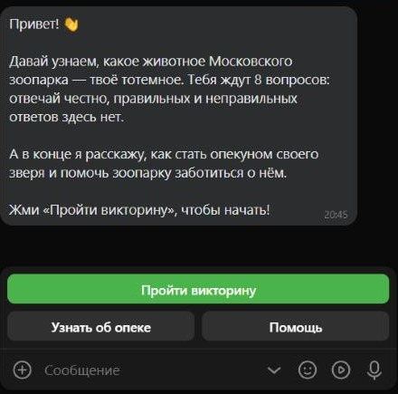
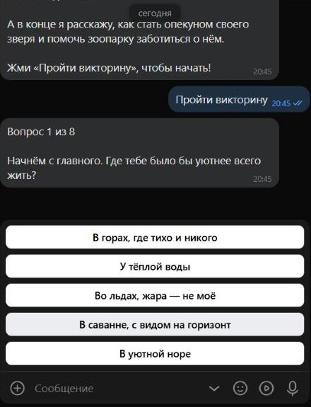
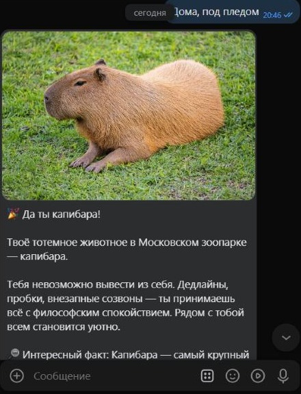
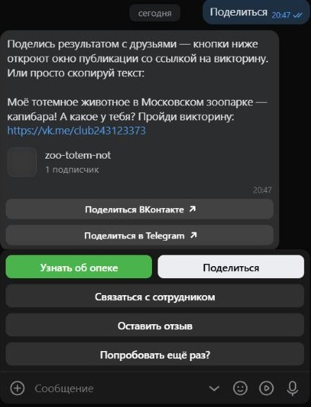
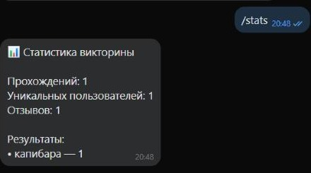

# Zoo Totem VK Bot — «Какое у вас тотемное животное?»

[English](README.md) | **Русский**

[](https://github.com/R00tPengu1n/Zoo-Totem-VK-Bot/actions/workflows/ci.yml)


[](LICENSE)


VK-бот-викторина для популяризации программы «Возьми животное под опеку» Московского зоопарка. Пользователь отвечает на 8 вопросов с юмором, бот подбирает ему тотемное животное из обитателей зоопарка, присылает реалистичное фото с описанием и рассказывает, как стать опекуном.

**Попробовать бота:** [открыть диалог во ВКонтакте](https://vk.me/club243123373)

## Демонстрация

<table align="center">
  <tr>
    <td align="center"><br><sub>Приветствие</sub></td>
    <td align="center"><br><sub>Вопрос</sub></td>
    <td align="center"><br><sub>Результат с фото</sub></td>
  </tr>
  <tr>
    <td align="center"><br><sub>Поделиться результатом</sub></td>
    <td align="center"><br><sub>Команда <code>/stats</code> для администратора</sub></td>
    <td></td>
  </tr>
</table>

## Возможности

- **Викторина из 8 вопросов** с вариантами ответов на кнопках и счётчиком прогресса
- **10 животных-результатов**: манул, сурикат, капибара, лев, жираф, белый медведь, фламинго, дикобраз, лошадь Пржевальского и пингвин Гумбольдта
- **Результат с фотографией**: фото загружается на сервер VK через `photos.getMessagesUploadServer` и `photos.saveMessagesPhoto` и кэшируется
- **Рассказ о программе опеки** с кнопкой-ссылкой на страницу программы
- **«Поделиться»** результатом во ВКонтакте и Telegram — со ссылкой на бота
- **Связь с сотрудником**: вопрос пользователя пересылается сотруднику вместе с результатом викторины
- **Отзывы** сохраняются в базу данных
- **«Попробовать ещё раз?»** — перезапуск викторины в любой момент
- **Статистика для администратора**: команда `/stats`
- **Подсказки на каждом шаге**: помощь, отмена, реакция на непонятные сообщения
- **Только личные сообщения**: сообщения из бесед бот игнорирует

## Стек

- Python 3.12+
- [vkbottle](https://github.com/vkbottle/vkbottle) — асинхронный фреймворк для VK-ботов
- [SQLAlchemy 2.0](https://www.sqlalchemy.org/) (async) + SQLite — с возможностью перехода на PostgreSQL
- [Pydantic](https://docs.pydantic.dev/) и pydantic-settings — проверка контента и настроек
- [aiohttp](https://docs.aiohttp.org/) — загрузка фотографий на сервер VK
- pytest — тесты, Docker — запуск в контейнере

## Архитектура

```
├── bot/
│   ├── __main__.py          # Точка входа: python -m bot
│   ├── config.py            # Настройки из .env
│   ├── loader.py            # Общие объекты: API, хранилище состояний, сервисы
│   ├── logging_config.py    # Логи в консоль и в файл с ротацией
│   ├── monitoring.py        # Время обработки сообщений и перехват ошибок
│   ├── middlewares.py       # Игнорирование бесед
│   ├── rules.py             # Правила выбора обработчика (кнопки и команды)
│   ├── states.py            # Состояния диалога
│   ├── keyboards.py         # Клавиатуры
│   ├── texts.py             # Все тексты для пользователя
│   ├── handlers/            # Обработчики сообщений
│   ├── services/
│   │   ├── content.py       # Загрузка и проверка вопросов и животных
│   │   ├── quiz_engine.py   # Подсчёт результата — чистая логика без VK
│   │   ├── photos.py        # Загрузка фото в VK с кэшированием и предзагрузкой
│   │   ├── startup_checks.py # Проверка настроек группы VK при запуске
│   │   └── notifier.py      # Пересылка вопросов сотруднику
│   └── db/                  # Модели, подключение и запросы к БД
├── data/
│   ├── questions.json       # Вопросы, ответы и веса
│   ├── animals.json         # Животные: описание, факт, фото
│   └── images/              # Фотографии животных
├── tests/                   # Тесты
├── .github/workflows/ci.yml # CI: ruff check, ruff format, pytest
├── Dockerfile
└── docker-compose.yml
```

### Как определяется результат

Каждый вариант ответа даёт баллы одному или нескольким животным:

```json
{"text": "В уютной норе", "weights": {"porcupine": 3, "meerkat": 2}}
```

Баллы суммируются по всем ответам, побеждает животное с наибольшей суммой; при равенстве выбирается случайное из лидеров. Веса подобраны так, что при случайных ответах каждое животное выпадает примерно в 9–12% случаев, а тест `test_every_animal_can_win` проверяет, что любое животное достижимо.

### Ключевые решения

- **Контент отделён от кода.** Вопросы и животные лежат в JSON — их можно править без программиста. При запуске файлы проверяются Pydantic-моделями: длина подписей кнопок, корректность весов, наличие фотографий. Ошибка в контенте не даст боту запуститься с некорректными данными.
- **Логика подсчёта изолирована.** `quiz_engine` не зависит от VK и БД, поэтому покрыт юнит-тестами.
- **Фото загружаются один раз.** Идентификатор вложения хранится в БД вместе с хэшем файла: если картинку заменить, бот загрузит новую версию автоматически.
- **Проверка настроек группы при запуске (fail fast).** Перед стартом бот спрашивает у VK настройки группы (`bot/services/startup_checks.py`). Если выключен Long Poll или не отмечено событие «Входящее сообщение», бот не запускается и пишет в лог, где это включить. Неверный ключ доступа тоже останавливает запуск с подсказкой проверить `VK_TOKEN`. «Возможности ботов» с ключом сообщества прочитать нельзя, поэтому при запуске они не проверяются: если они выключены, бот пишет подсказку в лог при первой ошибке VK 912 во время работы. Если саму проверку выполнить не удалось (сеть, сбой VK), это только предупреждение. Решение принимает чистая функция `find_problems`, она тестируется без сети.
- **Фоновая предзагрузка фото.** При старте фото всех животных загружаются в VK в фоне (`PhotoService.preload`) и кэшируются: запуск бота не задерживается, а первый ответ с фото не тормозит.
- **Только личные сообщения.** Прогресс викторины привязан к диалогу, и в беседе ответы разных людей смешались бы. Middleware (`bot/middlewares.py`) игнорирует сообщения из бесед.
- **Мониторинг.** Каждый обработчик обёрнут декоратором, который замеряет время обработки, предупреждает о медленных ответах и логирует ошибки с traceback, а пользователю отвечает понятным сообщением.
- **Конфиденциальность.** В БД хранятся только VK id, результат, дата и текст отзыва. Имя пользователя запрашивается только для письма сотруднику и не сохраняется. Токен хранится в `.env` и не попадает в репозиторий.
- **Масштабируемость.** Асинхронный код на vkbottle и SQLAlchemy; переход на PostgreSQL — смена `DATABASE_URL`.

## Установка и запуск

### 1. Настройка сообщества VK

1. Включите **сообщения сообщества**: Управление → Сообщения.
2. Там же, в **Сообщения → Настройки для бота**, включите **Возможности ботов**.
3. **Управление → Работа с API**: создайте ключ доступа с правами «управление сообществом», «сообщения сообщества», «фотографии». Это значение `VK_TOKEN`.
4. **Работа с API → Long Poll API**: включите Long Poll и выберите последнюю версию API.
5. На вкладке **Типы событий** отметьте **«Входящее сообщение»**.
6. Сотрудник, которому пересылаются вопросы, должен хотя бы раз написать сообществу (иначе VK не даст боту написать ему первым).
7. `BOT_LINK` задаётся в формате `https://vk.me/club<ID сообщества>` или с коротким именем: `https://vk.me/<короткое имя>`.

Пункты 4 и 5 бот проверяет сам при запуске и подсказывает в логе, что включить. Пункт 2 с ключом сообщества проверить нельзя: если он выключен, бот напишет подсказку в лог, когда VK вернёт ошибку 912.

### 2. Локальный запуск

```bash
git clone https://github.com/R00tPengu1n/Zoo-Totem-VK-Bot.git
cd Zoo-Totem-VK-Bot
python -m venv .venv
```

Windows: `.venv\Scripts\activate`, Linux / macOS: `source .venv/bin/activate`

```bash
pip install -r requirements.txt
```

Создайте `.env` по образцу `.env.example` и заполните `VK_TOKEN`, `ADMIN_VK_ID` и `BOT_LINK`.

```bash
python -m bot
```

### 3. Запуск в Docker

```bash
docker compose up -d --build
```

База данных и логи сохраняются в папках `storage/` и `logs/` на хосте.

## Настройки

| Переменная | Описание |
|---|---|
| `VK_TOKEN` | Ключ доступа сообщества |
| `ADMIN_VK_ID` | id или короткое имя сотрудника для пересылки вопросов |
| `BOT_LINK` | Ссылка на диалог с ботом для кнопки «Поделиться» |
| `GUARDIANSHIP_URL` | Страница программы опеки |
| `CONTACT_EMAIL` | Почта, которую бот предложит, если переслать вопрос не удалось |
| `DATABASE_URL` | Строка подключения к БД (по умолчанию SQLite в `storage/bot.db`) |
| `LOG_LEVEL` | Уровень логирования |
| `SLOW_HANDLER_THRESHOLD` | Порог медленной обработки в секундах |

## Как изменить викторину

- **Вопросы и ответы** — `data/questions.json`. Подпись ответа не длиннее 40 символов (ограничение VK), в одном вопросе от 2 до 6 вариантов.
- **Животные** — `data/animals.json`, фотографии — `data/images/`.
- После изменений запустите `pytest`: тесты проверят, что контент корректен и каждое животное может выпасть.

## Тесты и CI

```bash
pip install -r requirements-dev.txt
pytest
ruff check .
ruff format --check .
```

GitHub Actions (`.github/workflows/ci.yml`) запускает `ruff check .`, `ruff format --check .` и `pytest -q` на каждый push в `main` и на каждый pull request.

## Возможные проблемы

| Симптом | Причина и решение |
|---|---|
| `longpoll for this group is not enabled` (ошибка VK 100) | В сообществе выключен Long Poll. Включите: Управление → Работа с API → Long Poll API. |
| Бот запущен, но молчит, сообщения не приходят | На вкладке «Типы событий» не отмечено «Входящее сообщение». Бот проверяет это при старте и пишет понятную ошибку в лог. |
| `VKAPIError 912: This is a chat bot feature`, пользователь видит «Ой, что-то пошло не так» | Выключены «Возможности ботов»: Управление → Сообщения → Настройки для бота. Бот пишет подсказку в лог. |
| Бот останавливается при запуске: «проверь VK_TOKEN» | VK не принял ключ доступа сообщества (ошибка 5). Создайте новый ключ и пропишите его в `.env`. |
| Бот работает нестабильно или отвечает с перебоями | Запущено два экземпляра бота, и Long Poll конфликтует. Держите один (проверьте и локальный запуск, и контейнер Docker). |
| Первый ответ с фото медленный | Фото загружаются в VK при старте в фоне и кэшируются (`PhotoService.preload` в `bot/services/photos.py`). Пока предзагрузка не закончилась, первое фото может идти дольше. Проверка настроек группы при старте: `bot/services/startup_checks.py`. |

## Об учебном проекте

Проект выполнен в рамках курса SkillFactory «Python-разработчик PRO». Тема взята из учебного задания, связанного с программой «Возьми животное под опеку» Московского зоопарка. Это учебная работа, а не заказ и не продукт зоопарка.

## Ограничения и развитие

- Прогресс прохождения викторины хранится в памяти и сбрасывается при перезапуске бота. Следующий шаг — хранилище состояний в Redis.
- Таблицы создаются автоматически при запуске; для изменений схемы в продакшене стоит подключить миграции Alembic.
- Возможные доработки: картинка-карточка с результатом для публикации на стене, админ-панель для редактирования вопросов, рассылка новостей о подопечных.

## Лицензия

Код: [MIT](LICENSE). Фотографии: свободные лицензии их авторов, см. [CREDITS.md](CREDITS.md).

---

Проект не является официальным продуктом Московского зоопарка.

## Автор

GitHub: [@R00tPengu1n](https://github.com/R00tPengu1n)
